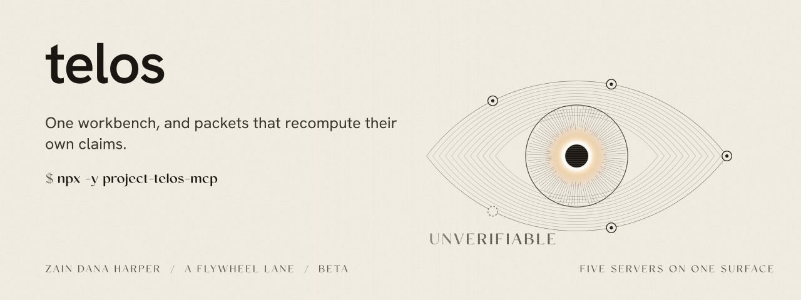

<picture>
  <source media="(prefers-color-scheme: dark)" srcset="docs/art/hero-dark.svg">
  
</picture>

# telos

Telos is a local MCP server and command line for AI agents. It gives an agent tools to read web pages and public APIs, triage a failed GitHub Actions run, check an HTML page for accessibility and size problems, and drive a browser or Windows app only after you grant permission from your own terminal. Each action leaves a record you can check again later.

[](https://www.npmjs.com/package/project-telos-mcp)
[](https://github.com/HarperZ9/telos/actions/workflows/ci.yml)
[](LICENSE)


[Project Telos](https://harperz9.github.io) | [gather](https://github.com/HarperZ9/gather) | [crucible](https://github.com/HarperZ9/crucible) | [index](https://github.com/HarperZ9/index) | [forum](https://github.com/HarperZ9/forum) | [telos](https://github.com/HarperZ9/telos) | [learn](https://github.com/HarperZ9/learn) | [emet](https://github.com/HarperZ9/emet) | [buildlang](https://github.com/HarperZ9/buildlang)

It is plain Node.js 20+ with no npm dependencies. The npm package is `project-telos-mcp`; it serves 50 tools over stdio to any MCP host, such as Claude Code, Codex or the OpenAI Agents SDK.

## What you get

- **Web and API reading.** `telos reach` and nine MCP tools read public pages, feeds and sitemaps through a crawler that obeys robots.txt and Crawl-delay. They also read Reddit through its official API with your own app, single X posts through X's oEmbed endpoint, and APIs such as Hacker News, GitHub, arXiv and Wikipedia. Every fetch records the URL, time, status, robots.txt decision and a SHA-256 of the bytes. The crawler reads HTML as served and does not run page JavaScript. Pages behind a login or a bot check are left out. See [the reach guide](docs/REACH.md).
- **Browser and desktop control behind a permission gate.** The CLI drives Chrome through the DevTools Protocol and Windows apps through UI Automation. Every verb has a risk tier. Nothing runs until you issue a signed grant with `telos grant issue`, which needs an interactive terminal, so an agent's own shell cannot grant itself access. Consequential actions also wait for a per-action confirmation. Password, OTP and card fields are refused under any grant. App control is Windows only. The MCP tool for this returns the catalog of verbs and performs no action. See [the tier spec](docs/spec/telos-tiers.md) and [the control contract](docs/native-control-contract.md).
- **An action log you can verify offline.** Gated actions, refusals included, append to a hash-chained log. After `telos keys init`, chain heads are signed with a local ed25519 key, and `telos receipts verify <session.jsonl>` detects edited, reordered, inserted or deleted entries, plus a cut-off tail once a checkpoint exists.
- **CI triage.** `ci-triage --gh-run owner/repo#run_id` reads a GitHub Actions run through the `gh` CLI and marks whether it failed on a blocking step or only on warnings, such as a deprecated action runtime. It names the failing step type and does not diagnose the test.
- **Static page checks.** `accessibility-doctor --html FILE` runs 14 static checks (language, viewport, skip link, landmarks, focus style, reduced motion, labels and more). `performance-doctor --html FILE` runs 14 byte-budget checks. Neither runs a browser.
- **Packets you can re-check.** `proof.mjs` builds a JSON record of an agent action, a research claim, a colour measurement or a build invariant, with the materials embedded. `proof.mjs verify` recomputes the hashes and values from those materials and reports MATCH, DRIFT (something was changed) or UNVERIFIABLE (something needed is missing). Packets are hash-checked and unsigned.

Telos also carries design work that is not a finished feature. The model foundry and learning forge are written contracts for routing and evaluating models: nothing in this repo calls a model or trains one. The causal, embodied and quantum packets are small fixed demonstrations, and the creative engine is a set of deterministic image kernels and meters behind [`demo/index.html`](demo/index.html). The presentation and operator doctors are tuned to the Project Telos repositories.

## Try it

Point an MCP host at the server without cloning anything:

```bash
npx -y project-telos-mcp
```

In a host config that is `"command": "npx"` with `"args": ["-y", "project-telos-mcp"]`. A `tools/list` call against 0.9.0 returns 50 tools.

To use the command line, install the package globally. That puts `telos` and `telos-mcp` on your PATH. (Run `telos` from the install, not through npx: the npm name `telos` belongs to an unrelated package.)

```bash
npm install -g project-telos-mcp
telos reach doctor
# reach doctor  7/12 channels ready
# web         ready               free
# reddit      needs credentials   set REDDIT_CLIENT_ID, REDDIT_CLIENT_SECRET
# ...

telos reach fetch https://example.com
# {"result": {"url": "https://example.com/", "status": 200, "page": {"title": "Example Domain", ...}},
#  "receipt": {"fetches": [{"url": "https://example.com/robots.txt", "robots": "robots.txt 404: no restrictions", ...

telos ci-triage --gh-run owner/repo#run_id --summary
# blocking     1
# verdict      DRIFT

telos accessibility-doctor --html page.html --summary
# checks       14
# passed       10
```

Without a grant, a control verb is refused before it runs:

```bash
telos native-control browser navigate https://example.com
# "status": "REFUSED", "tier": "T3", "executed": false, "reason": "NO_GRANT"
```

To run the demos from source:

```bash
git clone https://github.com/HarperZ9/telos.git
cd telos
node demo/run.mjs
#   RUN A (honest render)  : CERTIFIED      recheck=true
#   RUN B (broken render)  : UNVERIFIABLE   recheck=true
```

From a checkout, `npm start` (the same as `node demo/telos-mcp.mjs`) runs the stdio MCP server.

`demo/run.mjs` renders a 4-D cube, recovers its vertex and edge counts through separate image channels, and checks them against the known shape. A second render that is too small to read comes back UNVERIFIABLE, which shows the check can fail.

The outputs above come from `project-telos-mcp` 0.9.0 installed from npm (global install into a scratch prefix), run on Node 25 on Windows.

## How it compares

- **Browser automation servers such as Playwright MCP and Chrome DevTools MCP.** These offer far more browser coverage. Telos covers fewer verbs and adds Windows app control, a grant you sign from your own terminal, and a verifiable log of each action.
- **Hosted crawlers such as Firecrawl and Jina Reader.** These render JavaScript and run as services. `telos reach` runs on your machine, reads HTML as served, and stops where robots.txt says to stop.
- **Lighthouse and axe-core.** These load the page in a real browser and run far more rules. Telos's doctors are quick static checks on the HTML file.
- **Signed provenance such as in-toto and Sigstore.** These sign supply-chain attestations with managed keys and public logs. Telos's action log uses one local key, and its proof packets are hash-checked without a signature.

## Running all five Project Telos servers

`node demo/server-manifest.mjs` prints host config (Codex TOML, Claude JSON, OpenAI Agents) that launches Telos beside [gather](https://github.com/HarperZ9/gather), [index](https://github.com/HarperZ9/index), [forum](https://github.com/HarperZ9/forum) and [crucible](https://github.com/HarperZ9/crucible), for 78 tools in all plus 38 auxiliary compatibility tools. That setup expects all five repositories checked out side by side, with `PROJECT_TELOS_PUBLIC` set to their parent folder. The orientation commands:

```bash
node demo/catalog.mjs --summary          # 78 tools across the five servers
node demo/server-manifest.mjs --summary  # launch map with host config
```

Expected catalog summary:

```
Project Telos MCP Catalog
tools    78 total, 78 available
transport stdio, streamable-http
gather    5 tools ...
index     5 tools ...
forum     5 tools ...
crucible  13 tools ...
telos     50 tools ...
```

Health and state:

```bash
node demo/status.mjs --summary
node demo/doctor.mjs --summary
node demo/room.mjs --json
```

Each of these commands prints a JSON envelope with a MATCH, DRIFT, or UNVERIFIABLE status. The package's `telos` and `telos-mcp` commands route to the same scripts.

## See it work, step by step

The [animated explainer](https://harperz9.github.io/repo-explainers/telos.html)
walks through the tesseract loop certifying an honest render and returning UNVERIFIABLE for an 8 by 8 render, an agent-action proof packet verified from its own materials, and four edits that each come back DRIFT with the failing check named. Every value on it is output from this repository. Its
source is [docs/explainer/index.html](docs/explainer/index.html).

## Watch

[](https://harperz9.github.io/explainers.html#passing-check-h)

**[A passing check can still be wrong](https://harperz9.github.io/explainers.html#passing-check-h)** (2 min 24 s, narrated, captioned). Telos scores a render against a criterion the loop did not write, so a pass has to be earned. The film page carries the transcript, the sources and recall questions.

## Walkthrough

The demo loop and a proof packet, step by step. The commands and outputs match a run of 0.9.0 from a fresh clone.

1. **Install.** Run the MCP server without cloning, or clone to run the demos. Node 20 or newer, no dependencies.

   ```text
   $ npx -y project-telos-mcp
   $ git clone https://github.com/HarperZ9/telos.git && cd telos
   ```

2. **First run: two renders.** The demo checks a readable render and a broken one against the known shape of the cube.

   ```text
   $ node demo/run.mjs
     RUN A (honest render)  : CERTIFIED      recheck=true
     RUN B (broken render)  : UNVERIFIABLE   recheck=true
   ```

3. **Make a proof packet and verify it.** Write a packet for an agent action, then verify it from the packet alone.

   ```text
   $ node demo/proof.mjs agent-action --demo --json > packet.json
   $ node demo/proof.mjs verify packet.json
   verdict       MATCH
   witness       unavailable / UNVERIFIABLE
   ```

4. **An edited packet is named.** Change the packet and verify again.

   ```text
   $ node demo/proof.mjs verify edited.json
   packet_hash_mismatch (DRIFT)
   artifact_digest_mismatch (DRIFT) outputs[0].digest
   embedded_verdict_not_derived (DRIFT)
   ```

## Worked example: a proof packet that can fail

<p align="center"></p>

Assemble the demo agent-action proof packet, then replay its verification from the packet alone:

```bash
node demo/proof.mjs agent-action --demo --json > packet.json
node demo/proof.mjs verify packet.json
```

Expected output from a fresh clone:

```
verdict       MATCH
witness       unavailable / UNVERIFIABLE
```

The witness line reports a second, independent check by [emet](https://github.com/HarperZ9/emet). Telos looks for it in a sibling `../emet` checkout or at `TELOS_EMET_CLI`. When emet is present the line reads `witnessed / MATCH`; without it the packet records that no second check ran, and the verdict rests on the Telos verifier alone.

The packet joins source refs, context refs, route, admission decision, side effects, and output digests. The verifier recomputes digests from the embedded materials, so editing any load-bearing field flips the verdict to DRIFT, and a missing recomputable basis is reported as UNVERIFIABLE with the gap named by path. The other packet types work the same way: `research` recomputes source and negative-control digests and refuses reproduction-gated promotion in a single packet, `visual` recomputes color and luminance from embedded sRGB samples, and `build` recomputes a conserved-quantity invariant against a negative fixture that must break it. Details are in [docs/PROOF-LANES.md](docs/PROOF-LANES.md).

The verdict is computed from the checks, so a packet that carries its own `MATCH` cannot pass on that alone: when an embedded verdict disagrees with the derived one, the disagreement is itself recorded as a failure, and that failure inherits the derived severity. An embedded `MATCH` over tampered materials stays DRIFT. An embedded `MATCH` over an incomplete packet stays UNVERIFIABLE.

The emet check reads the packet's canonical bytes a second time. It can lower a verdict and never raises one. When emet cannot be reached, the packet records `witness_coverage: not_witnessed`. A MATCH says what was recomputed. It does not say that everything was looked at.

## Command surface

`node demo/catalog.mjs` is the authoritative map. Highlights by area:

| Area | Commands |
| --- | --- |
| Web and APIs | `reach.mjs` (doctor, menu, fetch, site, reddit, x, api) |
| Permissions and log | `grant.mjs`, `confirm.mjs`, `keys.mjs`, `receipts.mjs` |
| Orientation | `run.mjs`, `catalog.mjs`, `server-manifest.mjs`, `status.mjs`, `doctor.mjs`, `room.mjs` |
| Doctors | `ci-doctor.mjs`, `ci-triage.mjs`, `presentation-doctor.mjs`, `accessibility-doctor.mjs`, `performance-doctor.mjs`, `compatibility-doctor.mjs`, `operator-doctor.mjs`, `mcp-freshness.mjs` |
| Proof | `proof.mjs` (agent-action, research, visual, build, verify, export), `showcase.mjs` |
| Context | `context-envelope.mjs`, `context-pack.mjs`, `action-receipt.mjs`, `loop-ledger.mjs` |
| Creative | `creative-engine.mjs`, `creative-kernels.mjs`, `measurement-layers.mjs`, `rendering-capabilities.mjs`, `display-calibration.mjs` |
| Research | `causal-workbench-proof-packet.mjs`, `embodied-sim2real-proof-packet.mjs`, `quantum-error-correction-proof-packet.mjs`, `thermodynamic-ai-chip-receipt.mjs` |
| Foundry | `model-foundry.mjs`, `learning-forge.mjs`, `learning-forge-labs.mjs` |
| Workstation | `native-control.mjs`, `browser-evidence.mjs`, `workstation-substrate.mjs`, `revival-registry.mjs`, `second-level-flagship-queue.mjs` |

Most accept `--summary` for a compact terminal (TUI) view and `--json` for IDE, app, and automation hosts.

The doctors in full: `node demo/ci-doctor.mjs`, `node demo/presentation-doctor.mjs`, `node demo/accessibility-doctor.mjs`, `node demo/performance-doctor.mjs`, `node demo/compatibility-doctor.mjs`, and `node demo/operator-doctor.mjs`, plus `node demo/ci-triage.mjs` and `node demo/mcp-freshness.mjs`. Live CI intake works read-only: `node demo/ci-triage.mjs --gh-run owner/repo#run_id --summary`.

## Documentation

- [docs/INTRODUCTION.md](docs/INTRODUCTION.md): what Telos is and your first ten minutes.
- [docs/HOW-IT-WORKS.md](docs/HOW-IT-WORKS.md): the verifier loop, step by step, including where it stops.
- [docs/ARCHITECTURE.md](docs/ARCHITECTURE.md) and [docs/PROJECT-CONNECTION-MAP.md](docs/PROJECT-CONNECTION-MAP.md): system shape and how the five flagships connect.
- [docs/PROOF-LANES.md](docs/PROOF-LANES.md): the proof packet types and what each one recomputes.
- [docs/CURRENT-STATE.md](docs/CURRENT-STATE.md): current state of each surface.
- [USAGE.md](USAGE.md): install, run, MCP, and verify commands.

Peer repos: [gather](https://github.com/HarperZ9/gather) (research intake), [index](https://github.com/HarperZ9/index) (workspace maps and context), [forum](https://github.com/HarperZ9/forum) (agent routing with a causal ledger), [crucible](https://github.com/HarperZ9/crucible) (claim verification), [emet](https://github.com/HarperZ9/emet) (independent second check). Telos can launch gather, index, forum and crucible beside itself from one manifest; each also stands alone.

## Status and maturity

`project-telos-mcp` 0.9.0 is the current release, published on [npm](https://www.npmjs.com/package/project-telos-mcp/v/0.9.0) with matching [GitHub release artifacts](https://github.com/HarperZ9/telos/releases/tag/v0.9.0). The command surface above is tested and CI-covered: `npm test` globs every test file in `demo/`, so a new one runs without being added to a list. Interfaces may still move between minor versions. Research packets are deterministic preflights with explicit non-claims: the causal packet does not claim causal discovery, the embodied packet does not claim real-robot safety, the quantum packet does not claim hardware QEC. The tests in this repo are the evidence for each claim here.

### Upgrading from 0.2.0

0.3.0 writes native-control ledger hash version 2, binding session metadata and
entry fields. Upgrade readers before writers: 0.2.0 readers reject the new
format. New readers still accept legacy receipts with a limited step/result
integrity scope. Browser evidence now reports `unredacted`; URLs, titles,
selectors, artifact references, and supplied summaries can remain in packets.
Keep these packets private. Hash consistency does not prove execution truth,
authorship, completeness, or safety. See [release notes](docs/RELEASE-NOTES-0.3.0.md).

The roadmap is [`docs/PROJECT-TELOS-LARGE-SCALE-ROADMAP-2026-07-02.md`](docs/PROJECT-TELOS-LARGE-SCALE-ROADMAP-2026-07-02.md), and the documentation index is [`docs/DOCUMENTATION-CONSOLIDATION-REGISTRY-2026-07-02.md`](docs/DOCUMENTATION-CONSOLIDATION-REGISTRY-2026-07-02.md) with the machine-readable registry under [`docs/registry/`](docs/registry/).

## What a record looks like

Most commands here print a JSON record that someone else can check later. When a check cannot be completed, the answer is UNVERIFIABLE, and each verifier has tests that make it fail on bad input.

Here is one record, from the artwork checker, drawn field by field. Run it yourself with `python tools/check_repo_art.py --json`:

<p align="center"></p>

The picture is generated from the same spec the checker reads, and a CI check compares every value in it with a record the tool emits, so the picture fails CI if it goes out of date.

## License

Text: CC BY 4.0. Code: FSL-1.1-MIT.

The whitepapers and research notes in [`docs/research/`](docs/research/) are
licensed CC BY 4.0. Share and adapt them with credit to Zain Dana Harper; the
terms are in [`LICENSE-TEXT`](LICENSE-TEXT).

The code and the software documentation are FSL-1.1-MIT (fair source). The code is open to read and run, free for nearly any use except building a competing product, and each release converts to the MIT license after two years. Copyright is held by the author. See [LICENSE](LICENSE).

Version 0.9.0 and earlier releases were published under FSL-1.1-ALv2 and keep that license, so each of them still converts to Apache 2.0. FSL-1.1-MIT applies from the next release.

## For developers

Zero dependencies, so there is nothing to install. Run the MCP contract tests and smoke checks before opening a PR:

```bash
npm run test:mcp
node demo/catalog.mjs --summary
node demo/server-manifest.mjs --summary
node demo/room.mjs --json
```

CI (`.github/workflows/ci.yml`) runs each contract test file individually on Node 24; run any of them directly with `node demo/<name>.test.mjs`. Keep the README, package metadata, and examples aligned with current behavior; `node demo/operator-doctor.mjs --summary` checks that parity.

---

**[Zain Dana Harper](https://github.com/HarperZ9)** builds evidence-first tools that leave a re-checkable artifact behind, in Seattle. The full workbench is at [Project Telos](https://harperz9.github.io).

---

## The Zain Dana Harper ecosystem

This tool is one part of a family that holds a single belief steady across
every surface: knowledge open to anyone who can attain the means; acceptance
decided by external checks, never reputation; every result re-runnable;
honest nulls first-class; ownership earned by comprehension; learning woven
into the work.

- **[Workspace canon](https://github.com/HarperZ9/workspace)**: AGENTS.md, CREDO.md, MISSION.md, ECOSYSTEM.md
- **[Flywheel](https://github.com/HarperZ9/flywheel)**: the one platform (receipts, governance, infra controls, learning loop)
- **[Getting Started](https://github.com/HarperZ9/flywheel/blob/main/GETTING-STARTED.md)**: your first thirty minutes

Built by **[Zain Dana Harper](https://github.com/HarperZ9)** in Seattle.

## Local client packages

The [0.9.0 release](https://github.com/HarperZ9/telos/releases/tag/v0.9.0) includes
native Windows ZIP and MCPB client packages. Marketplace acceptance is not
established by publication of these archives.

### Installation

See [the client package guide](client-plugin/README.md) for scoped skills, portable MCP configuration and same-release archives.
